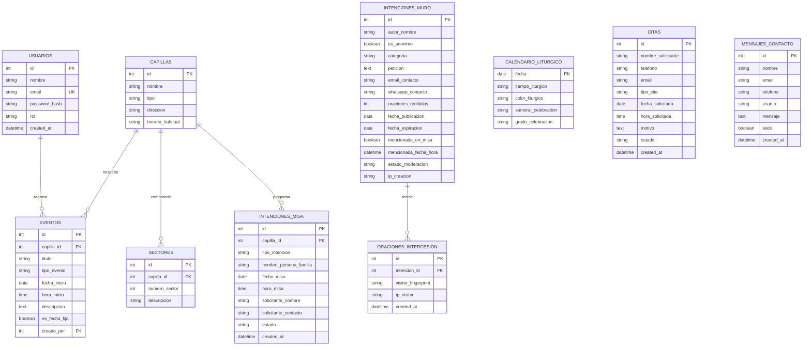

# Vinea Comunidad — Organización y Arquitectura del Sistema (Fase 2)

**Proyecto:** Vinea Comunidad (Portal Web Parroquial)  
**Organización:** Parroquia María Madre de Dios (Tehuacán, Puebla) — Diócesis de Tehuacán  
**Asignatura:** Desarrollo de Aplicaciones Web  
**Docente:** Yedid Curioca Varela  
**Institución:** Universidad Tecnológica de Tehuacán — TSU en Tecnologías de la Información  
**Equipo de Trabajo:**
- Sandra Belén De La Cruz Morales
- Anthony Pérez Bautista
- Guadalupe Amayrani Méndez Huerta
- Zamira Pérez Ponce
- José Elián Martínez Morales
- Luis Ángel Cisneros  
**Agente Técnico:** Vinea-Web  
**Versión:** 1.0  
**Fecha:** 5 de octubre de 2026  

---

## 1. Introducción y Enfoque Arquitectónico

En esta fase se define la arquitectura de información, la estructura de navegación, la organización de contenidos y la jerarquía de archivos y directorios de **Vinea Comunidad**.

El diseño arquitectónico responde a tres principios fundamentales:
1. **Separación estricta de responsabilidades:** Presentación desacoplada (HTML5 semántico, CSS3 modular en `css/styles.css`, interactividad JS nativa en `js/`), capa de servicios API RESTful ligera en `api/` (PHP con PDO) y capa administrativa segura en `admin/`.
2. **Cumplimiento de los requisitos académicos:** Integración armónica de las 6 secciones mínimas requeridas por la asignatura (Inicio, Información de la institución, Servicios pastorales, Galería, Avisos y eventos, Contacto) con los 6 módulos funcionales especializados de la parroquia.
3. **Sostenibilidad para el equipo:** Uso de tecnologías estándar, comprensibles y fácilmente desplegables en servidores compartidos gratuitos con soporte PHP 8.x y MySQL/MariaDB.

---

## 2. Mapa del Sitio (Sitemap) y Arquitectura de Información

```mermaid
graph TD
    A[Inicio / Portada Principal] --> B[Nuestra Parroquia - Info Institucional]
    A --> C[Servicios Pastorales y Sacramentos]
    A --> D[Calendario Litúrgico y Eventos]
    A --> E[Muro de Oraciones e Intenciones]
    A --> F[Grupos y Voluntariado]
    A --> G[Galería Parroquial]
    A --> H[Contacto y Notaría]
    
    B --> B1[Historia y Misión Diocesana]
    B --> B2[Equipo Sacerdotal y Pastoral]
    B --> B3[Directorio de Capillas y Sectores]
    B --> B4[Mapa Interactivo de Ubicación]
    
    C --> C1[Guía de Sacramentos: Bautismo, Comunión, Confirmación, Matrimonio]
    C --> C2[Requisitos Descargables en PDF]
    C --> C3[Estipendios Orientativos de Donativo]
    C --> C4[Solicitud de Intención de Misa]
    C --> C5[Agenda de Citas con el Párroco]
    
    D --> D1[Vista de Calendario Mensual Interactivo]
    D --> D2[Selector de Filtro por Capilla]
    D --> D3[Fechas Fijas de Primera Comunión y Confirmación]
    D --> D4[Identificador Litúrgico del Día]
    D --> D5[Lista Accesible Móvil de Próximos Eventos]
    
    E --> E1[Publicación de Petición con o sin Anonimato]
    E --> E2[Velitas Virtuales Activas de 7 Días]
    E --> E3[Intercesión: Yo Rezo por Ti y Flama Dinámica]
    E --> E4[Avisos de Oraciones Recibidas]
    
    F --> F1[Fichas de Ministerios y Coros]
    F --> F2[Botón CTA WhatsApp: Unirme al Grupo]
    
    H --> H1[Horarios de Atención de Notaría]
    H --> H2[Formulario de Mensajes]
    H --> H3[Botón Flotante y Enlace wa.me]
    
    subgraph Panel Administrativo
    X[Acceso Restringido: admin/] --> X1[Login con Sesión Segura]
    X1 --> X2[Dashboard Resumen]
    X1 --> X3[Gestor de Eventos y Calendario Litúrgico]
    X1 --> X4[Gestor de Citas e Intenciones de Misa]
    X1 --> X5[Consolidado del Muro para Oración de los Fieles]
    X1 --> X6[Moderación de Contenidos y Mensajes]
    end
```



---

## 3. Integración: Secciones Académicas y Módulos Pastorales

| Secciòn Mìnima (Actividad) | Mòdulos Especìficos Integrados | Contenido Clave y Componentes |
|---|---|---|
| **1. Inicio** | Portada general y accesos ràpidos | Hero con lema parroquial, accesos directos a horarios de misa de hoy, botòn directo al Muro de Oraciones, llamados a la acciòn principales y botòn flotante de WhatsApp. |
| **2. Informaciòn de la Parroquia** | Mòdulo 1 (Informaciòn institucional y contacto) | Reseña històrica, bienvenida del pàrroco, equipo sacerdotal y pastoral, directorio de capillas filiales y sectores (ej. Capilla del Observatorio - Sectores 14 y 15) y mapa interactivo incrustado. |
| **3. Servicios Pastorales (Productos/Servicios)** | Mòdulo 2 (Sacramentos y tràmites) y Mòdulo 3 (Servicios, intenciones y citas) | Guìa interactiva en pestañas por sacramento con requisitos y descarga en PDF, formulario para solicitar intenciones de misa y agenda de citas pastorales. |
| **4. Avisos y Eventos (Promociones/Relevante)** | Mòdulo 4 (Calendario litùrgico y eventos) | Calendario mensual dinàmico con selector de capilla, colores del tiempo litùrgico, santoral, fechas fijas de comuniòn y confirmaciòn y cartelera de avisos comunitarios. |
| **5. Grupos y Comunidad** | Mòdulo 5 (Grupos parroquiales y voluntariado) | Fichas de catequesis, pastoral juvenil, coro, Càritas y ministros, con horarios de reuniòn y botòn `wa.me` *"Unirme al grupo"*. |
| **6. Espacio Devocional** | Mòdulo 6 (Muro de Oraciones e Intenciones Virtuales) | Muro comunitario de velitas encendidas con flama interactiva animada por oraciones recibidas, formulario de peticiòn y consulta periòdica automàtica. |
| **7. Galerìa** | Galerìa de vida comunitaria | Fotografìas de la vida litùrgica, festividades patronales, celebraciones de sacramentos y labor social comunitaria, con textos `alt` descriptivos y carga diferida (`loading="lazy"`). |
| **8. Contacto** | Mòdulo 1 y atenciòn de notarìa | Horarios de oficina, ubicaciòn fìsica, telèfonos, formulario de mensajes directos, enlace `wa.me` y aviso de privacidad legal. |

---

## 4. Estructura de Navegación y Usabilidad

### 4.1 Barra de Navegación Principal (Navbar)
- Posición fija superior (`sticky-top`) con contraste accesible y sombra sutil.
- Enlace oculto inicial `"Saltar al contenido principal"` (`.skip-link`) visible únicamente al enfocar con teclado (tecla Tab) para usuarios con lectores de pantalla o discapacidad motriz.
- Menú colapsable en pantallas móviles mediante botón de hamburguesa accesible (`aria-label="Abrir menú de navegación"`, `aria-expanded="false"`).
- Estructura de elementos:
  1. *Logo institucional:* Isotipo y nombre "Parroquia María Madre de Dios".
  2. *Enlaces principales:* Inicio | La Parroquia | Sacramentos | Calendario | Muro de Oraciones | Grupos | Galería | Contacto.
  3. *Acceso administrativo:* Ícono sutil de candado que conduce a `admin/login.php` al pie de página y en menú secundario.

### 4.2 Experiencia Móvil (*Mobile-First*)
- En pantallas táctiles (< 768 px), la barra de navegación se repliega y los componentes complejos (como el calendario) ofrecen una visualización alternativa en lista lineal cronológica de próximos eventos para evitar el desplazamiento horizontal incómodo.
- Botón flotante de WhatsApp posicionado en la esquina inferior derecha con margen de separación suficiente para no obstruir los botones de acción inferior.

---

## 5. Arquitectura del Panel de Administración (`admin/`)

El panel de control está diseñado bajo el patrón de **Autenticación Basada en Sesión PHP (Session-based Auth)** con verificación centralizada en cada petición:

```
admin/
├── login.php              -> Formulario de autenticación con protección CSRF
├── logout.php             -> Destrucción segura de sesión y redirección
├── auth_check.php         -> Middleware de inclusión obligatoria en toda vista protegida
├── index.php              -> Dashboard con métricas clave (citas pendientes, velitas activas)
├── eventos.php            -> Creación, edición y borrado de eventos y fechas de sacramentos
├── citas.php              -> Gestión de citas pastorales y marcado como "Atendida / Confirmada"
├── intenciones.php        -> Consolidado sacerdotal para la Oración de los Fieles y botón wa.me
├── muro_admin.php         -> Moderación de peticiones del muro (ocultar / reactivar / eliminar)
├── mensajes.php           -> Bandeja de entrada de mensajes de contacto
└── includes/
    ├── header.php         -> Cabecera común del panel, estilos y navegación interna
    └── footer.php         -> Cierre de etiquetas y scripts administrativos
```

**Regla de seguridad (RNF-03):** Cualquier intento de acceso directo por URL a archivos como `admin/eventos.php` o `admin/intenciones.php` sin una sesión activa (`$_SESSION['user_id']`) dispara inmediatamente una redirección HTTP 302 hacia `admin/login.php`.

---

## 6. Arquitectura de la API Backend (`api/`)

Los endpoints PHP actúan como puente entre la interfaz web y la base de datos MySQL, devolviendo respuestas en formato estandarizado JSON:

```
api/
├── config.php             -> Credenciales PDO, encabezados CORS/JSON y funciones de sanitización
├── eventos.php            -> Endpoint para consulta de eventos filtrados por mes y capilla
├── intenciones.php        -> Endpoint para listar velitas activas, publicar petición y orar ("Yo rezo por ti")
├── citas.php              -> Endpoint para registrar solicitudes de citas pastorales
├── contacto.php           -> Endpoint para recepción y almacenamiento de mensajes
└── liturgico.php          -> Endpoint para consultar el color del tiempo litúrgico y santoral del día
```

**Estructura estándar de respuesta JSON:**
```json
{
  "status": "success",
  "data": { ... },
  "message": "Operación completada exitosamente."
}
```

---

## 7. Esquema de Base de Datos Relacional (`sql/schema.sql`)



---

## 8. Estructura Obligatoria de Directorios del Proyecto

La estructura física creada en el entorno de desarrollo refleja con exactitud la especificación:

```
vinea-comunidad/
├── index.html                   # Página principal interactiva con todas las secciones
├── css/
│   └── styles.css               # Estilos personalizados, variables de identidad y animaciones de velitas
├── js/
│   ├── main.js                  # Lógica general, menú móvil, desplazamiento suave y mapa
│   ├── calendario.js            # Lógica del calendario litúrgico y filtro por capilla
│   ├── muro.js                  # Lógica del Muro de Oraciones, velitas interactivas y polling
│   └── sacramentos.js           # Guías de sacramentos, citas e intenciones
├── img/
│   ├── hero-parroquia.jpg       # Imagen de cabecera del templo
│   ├── virgen-maria.jpg         # Imagen titular María Madre de Dios
│   ├── capillas/                # Fotografías de capillas filiales
│   ├── galeria/                 # Fotografías de eventos y celebraciones
│   └── icons/                   # Íconos de velita, cruz, cáliz y paloma
├── api/
│   ├── config.php               # Conexión PDO, CORS y sanitización
│   ├── eventos.php              # API de eventos y calendario
│   ├── intenciones.php          # API del Muro de Oraciones y velitas
│   ├── citas.php                # API para agendar citas
│   ├── contacto.php             # API de formulario de contacto
│   └── liturgico.php            # API del calendario litúrgico
├── admin/
│   ├── login.php                # Inicio de sesión con password_hash
│   ├── logout.php               # Cierre de sesión seguro
│   ├── auth_check.php           # Verificador de sesión activa
│   ├── index.php                # Dashboard principal con métricas
│   ├── eventos.php              # Administrador de calendario y fechas fijas
│   ├── citas.php                # Administrador de citas
│   ├── intenciones.php          # Consolidado para la Oración de los Fieles
│   ├── muro_admin.php           # Moderación de peticiones
│   └── mensajes.php             # Buzón de mensajes
├── sql/
│   ├── schema.sql               # Estructura DDL de tablas relacionales
│   └── datos_ejemplo.sql        # Semillas de prueba, capillas y santoral
├── docs/
│   ├── datos_proyecto.md        # Fase 0: Identidad, problemas y supuestos
│   ├── fase1_analisis_requerimientos.md # Fase 1: Requerimientos funcionales y RNF
│   ├── fase2_organizacion_arquitectura.md # Fase 2: Este documento de arquitectura
│   ├── fase3_experiencia_usuario_ux.md   # Fase 3: Próxima fase (flujos de usuario)
│   ├── fase4_diseno_interfaz_ui_usabilidad.md # Fase 4: Diseño visual e interfaz
│   └── fase5_desarrollo_implementacion.md # Fase 5: Implementación y pruebas
└── README.md                    # Documentación general y guía de despliegue
```

---

## 9. Registro de Trabajo del Agente (Fase 2)

| Campo | Detalle |
|---|---|
| **Fecha de ejecución** | 5 de octubre de 2026 |
| **Instrucción recibida** | Desarrollar la Fase 2: Organización y arquitectura, definiendo sitemap, integración de secciones mínimas con los 6 módulos, arquitectura del panel `admin/`, endpoints `api/`, esquema ER de base de datos y árbol de directorios. |
| **Resultado obtenido** | Documento `docs/fase2_organizacion_arquitectura.md` completado con diagramas Mermaid de navegación y de entidad-relación, especificación de endpoints REST, matriz de integración académica y estructura física de directorios. |
| **Decisión tomada 1** | Se adoptó un portal unificado con arquitectura modular de secciones accesibles por navegación suave y enlaces profundos, complementado con un panel administrativo independiente en la carpeta `admin/`. |
| **Motivo** | Facilita al usuario feligrés la consulta continua sin recargas de página innecesarias, mientras que aísla de forma hermética la gestión administrativa para mayor seguridad. |
| **Alternativa descartada** | Múltiples páginas HTML estáticas inconexas; se descartó por entorpecer la experiencia devocional continua del Muro de Oraciones y del Calendario interactivo. |
| **Decisión tomada 2** | Los endpoints en `api/` se diseñan con PHP vanilla y PDO sin frameworks (Laravel/Symfony). |
| **Motivo** | Máxima portabilidad y compatibilidad garantizada en cualquier servicio de hosting gratuito sin requerir Composer o terminal SSH en el servidor. |
| **Alternativa descartada** | Microframeworks como Slim o Lumen; descartados para asegurar que el equipo pueda explicar y sostener el código con facilidad en su evaluación. |

---
*Fin del documento de Fase 2. Pendiente de revisión y confirmación del equipo para dar paso a la Fase 3.*
