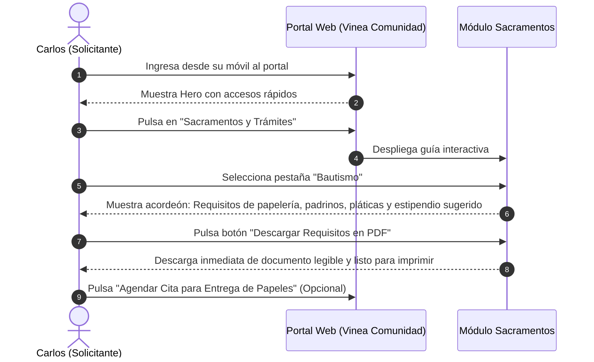
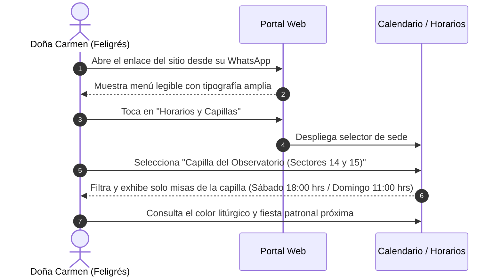
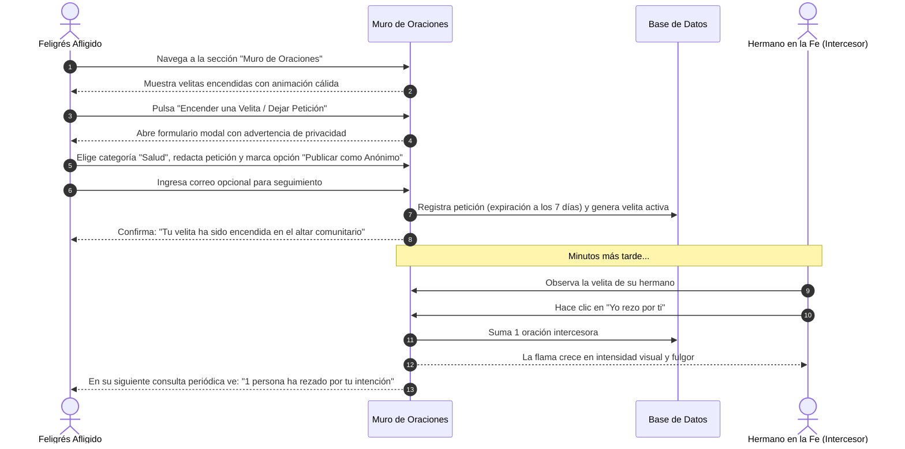
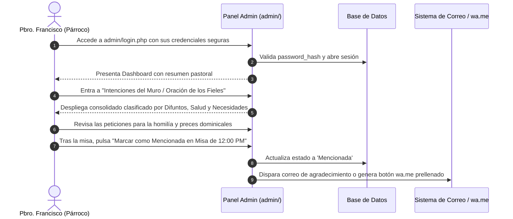
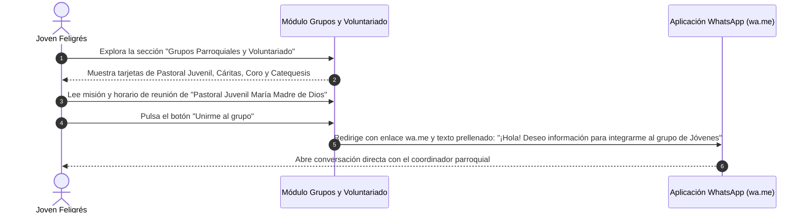

# Vinea Comunidad — Experiencia de Usuario (UX) (Fase 3)

**Proyecto:** Vinea Comunidad (Portal Web Parroquial)  
**Organización:** Parroquia María Madre de Dios (Tehuacán, Puebla) — Diócesis de Tehuacán  
**Asignatura:** Desarrollo de Aplicaciones Web  
**Docente:** Yedid Curioca Varela  
**Institución:** Universidad Tecnológica de Tehuacán — TSU en Tecnologías de la Información  
**Equipo de Trabajo:**
- Sandra Belén De La Cruz Morales
- Anthony Pérez Bautista
- Guadalupe Amayrani Méndez Huerta
- Zamira Pérez Ponce
- José Elián Martínez Morales
- Luis Ángel Cisneros  
**Agente Técnico:** Vinea-Web  
**Versión:** 1.0  
**Fecha:** 5 de octubre de 2026  

---

## 1. Introducción y Enfoque Centrado en la Persona

La experiencia de usuario de **Vinea Comunidad** está concebida a partir de la empatía pastoral. El público que interactúa con una parroquia católica es profundamente heterogéneo: abarca desde adultos mayores con destrezas digitales iniciales hasta jóvenes que buscan integrarse a un ministerio, así como familias en momentos trascendentales (nacimientos, bodas o pérdida de seres queridos).

Por ello, el diseño UX se rige por tres premisas:
1. **Calidez y respeto litúrgico:** El tono del sitio es acogedor, solemne y cercano.
2. **Claridad sin barreras:** La información vital (horarios, requisitos y citas) está a un máximo de dos clics desde la portada.
3. **Inclusión y accesibilidad:** Componentes de gran tamaño táctil, contraste óptimo y textos claros que no asumen familiaridad con terminología informática.

---

## 2. Arquetipos de Usuario (User Personas)

### Persona 1: Doña Carmen (Feligrés Comunitaria)
- **Edad:** 64 años.
- **Ocupación:** Jubilada y abuela; vive en la colonia del Observatorio (Sector 14).
- **Competencia digital:** Baja-Media. Utiliza teléfono inteligente para WhatsApp y llamadas; le cuesta leer tipografías pequeñas y se siente insegura con formularios extensos.
- **Objetivos:** Saber a qué hora es la misa en su capilla este fin de semana sin tener que caminar hasta el templo sede; pedir oración por la salud de su hermana enferma.
- **Frustraciones previas:** En Facebook no encuentra la información de su sector porque se pierde entre publicaciones de otras capillas; la notaría suele estar cerrada cuando ella tiene tiempo de ir.
- **Solución en Vinea Comunidad:** Filtro directo por "Capilla del Observatorio" en la cartelera de horarios; botón táctil grande para encender una velita en el Muro de Oraciones con un solo formulario simple.

---

### Persona 2: Carlos y Mariana (Solicitantes de Sacramento)
- **Edad:** 29 y 27 años.
- **Ocupación:** Empleados de comercio en Tehuacán; padres de una bebé de 4 meses.
- **Competencia digital:** Alta. Navegan 100% desde su teléfono móvil y esperan resolver trámites rápidamente.
- **Objetivos:** Conocer con exactitud los requisitos para bautizar a su hija, saber si sus compadres cumplen con el perfil de padrinos, conocer los estipendios de recuperación sugeridos y descargar la lista en PDF para revisarla en casa.
- **Frustraciones previas:** Tuvieron que pedir permiso en el trabajo para ir a la oficina parroquial a las 4 de la tarde solo para que les entregaran un volante fotocopiado con requisitos.
- **Solución en Vinea Comunidad:** Pestaña de Bautismo con acordeón interactivo que explica requisitos de papelería, edad de la niña, condiciones de los padrinos y botón directo para descargar el PDF imprimible oficial.

---

### Persona 3: Pbro. Francisco (Párroco y Administrador Pastoral)
- **Edad:** 53 años.
- **Ocupación:** Párroco de María Madre de Dios y responsable espiritual de la comunidad.
- **Competencia digital:** Media. Utiliza laptop y celular para tareas pastorales.
- **Objetivos:** Llegar al presbiterio el domingo con la lista consolidada y clasificada de las intenciones de la comunidad (enfermos, difuntos, acciones de gracias) para la Oración de los Fieles; revisar solicitudes de citas de acompañamiento espiritual.
- **Frustraciones previas:** Los papelitos de intenciones se extraviaban o llegaban minutos antes de comenzar la misa, dificultando su lectura digna y pausada.
- **Solución en Vinea Comunidad:** Panel pastoral con vista consolidada de la semana lista para imprimir o visualizar en tableta, con botón de un clic para marcar *"Mencionada en misa"*, lo cual notifica con gratitud al feligrés.

---

### Persona 4: Mateo (Sacristán y Notario Parroquial)
- **Edad:** 34 años.
- **Ocupación:** Asistente operativo y responsable del orden litúrgico y de notaría.
- **Competencia digital:** Media-Alta.
- **Objetivos:** Mantener al día los avisos parroquiales y el calendario de misas de las capillas; evitar responder cincuenta veces al día las mismas preguntas sobre bautismos y confirmaciones.
- **Frustraciones previas:** Saturación telefónica y reclamos de feligreses que asistieron a capillas en horarios que ya habían cambiado.
- **Solución en Vinea Comunidad:** Panel ágil para actualizar eventos en el calendario litúrgico y fijar con anticipación las fechas de comuniones y confirmaciones comunitarias.

---

## 3. Recorridos de Usuario Detallados (User Journeys)

### Recorrido 1: Consultar requisitos de Bautismo y descargar lista en PDF

- **Punto de satisfacción:** Encuentra la información completa en menos de 40 segundos, sin desplazarse ni esperar el horario de oficina.

---

### Recorrido 2: Consultar horarios de misa de la Capilla del Observatorio

- **Punto de satisfacción:** Evita desplazamientos innecesarios y tiene certeza del horario en su propio sector barrial.

---

### Recorrido 3: Publicar una intención comunitaria y encender una velita virtual

- **Punto de satisfacción:** Confort espiritual inmediato, respaldo comunitario visible y protección total de su identidad personal.

---

### Recorrido 4: Párroco prepara la Oración de los Fieles dominical

- **Punto de satisfacción:** La oración litúrgica se conecta directamente con los anhelos y dolores reales de sus feligreses.

---

### Recorrido 5: Integración a voluntariado juvenil o Cáritas vía WhatsApp

- **Punto de satisfacción:** Sin trámites burocráticos ni intermediarios; vinculación ágil e inmediata a la vida comunitaria.

---

## 4. Principios de Usabilidad e Inclusión Aplicados

1. **Diseño Visual con Metáforas Significativas:**
   - La **velita virtual** reproduce el gesto devocional universal de encender una cera votiva ante el Santísimo o la Virgen María.
   - El crecimiento dinámico de la flama simboliza la llama viva de la caridad y la oración compartida.
2. **Prevención Activa de Errores y Protección Emocional:**
   - Al redactar una petición, el sistema alerta amablemente: *"Por respeto y protección de tu familia, no ingreses apellidos completos, números de teléfono ni diagnósticos médicos detallados"*.
   - Los campos obligatorios están señalizados con claridad y cuentan con validación en tiempo real antes de enviar.
3. **Control y Autonomía del Usuario:**
   - Todo visitante puede elegir publicar con su nombre de pila o mantener el anonimato estricto.
   - Se provee retroalimentación visual clara (pantalla de confirmación con bendición pastoral tras cada envío).
4. **Respuesta Rápida y Estados del Sistema:**
   - En peticiones asíncronas se despliegan spinners discretos de carga; los botones deshabilitan temporalmente el doble clic para evitar duplicidad de oraciones o envíos involuntarios.
5. **Navegación Táctil Cómoda en Dispositivos Móviles:**
   - Objetivos táctiles de al menos 48x48 píxeles de área activa para evitar toques accidentales por usuarios de edad avanzada o con temblor fino.

---

## 5. Registro de Trabajo del Agente (Fase 3)

| Campo | Detalle |
|---|---|
| **Fecha de ejecución** | 5 de octubre de 2026 |
| **Instrucción recibida** | Desarrollar la Fase 3: Experiencia de usuario (UX), describiendo usuarios, necesidades, recorridos representativos (bautismo, cita con el párroco, consulta de capilla, muro de oraciones, oración de los fieles dominical) y organización de la experiencia. |
| **Resultado obtenido** | Documento `docs/fase3_experiencia_usuario_ux.md` con 4 arquetipos de usuario contextualizados en Tehuacán, 5 diagramas de secuencia de recorridos de usuario, matrices de puntos de contacto y especificación de usabilidad inclusiva para adultos mayores. |
| **Decisión tomada 1** | Se diseñó el flujo del Muro de Oraciones con una experiencia asimétrica positiva: el autor publica y recibe retroalimentación pasiva de cuántos han orado por él, mientras que cualquier visitante puede interceder con un solo toque ("Yo rezo por ti") sin necesidad de registrarse. |
| **Motivo** | Eliminar cualquier barrera de fricción para la oración solidaria en la comunidad parroquial. |
| **Alternativa descartada** | Requerir registro con cuenta de correo y contraseña para rezar por una intención; descartado por alienar a más del 80% de los visitantes mayores y casuales. |
| **Decisión tomada 2** | Se incluyeron advertencias de privacidad visibles en el formulario devocional para evitar exposición involuntaria de datos médicos o nombres de terceros. |
| **Motivo** | Cumplir el requisito no funcional RNF-10 y proteger la dignidad y seguridad de las familias. |
| **Alternativa descartada** | Permitir texto libre sin advertencias ni moderación; descartado por los riesgos de difamación o filtración de datos sensibles. |

---
*Fin del documento de Fase 3. Pendiente de revisión y confirmación del equipo para dar paso a la Fase 4.*
